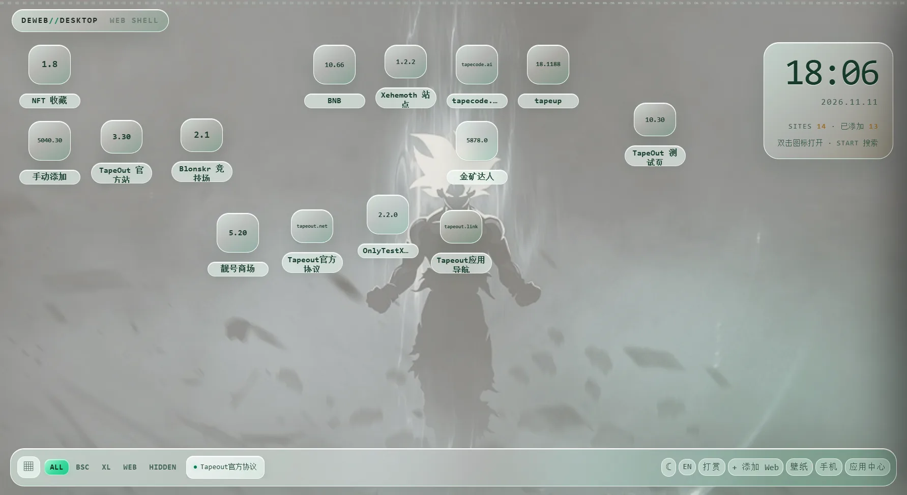

# DeWEB Desktop · 应用说明

> 让链上应用，像桌面应用一样自然。



## 一句话

DeWEB Desktop 是面向 DeWEB 的桌面入口：把链上站点、Web 应用、钱包和本地资料，收进一个可拖拽、可平铺、可本地保存的工作空间。

它不是另一个浏览器，而是 DeWEB 的第一层桌面。

## 它解决什么问题

DeWEB 站点越来越多，但入口仍然是散的：

- 每个站点是独立域名，用户要记地址；
- BSC / X Layer 网络要手动切换；
- 钱包连接、签名、二维码在不同窗口里来回跳；
- 没有一个统一的应用中心；
- 浏览器标签页会互相遮挡，桌面资料也无法跟着站点走。

DeWEB Desktop 把这些动作收进一个桌面：

```text
发现站点 → 一键添加 → 原生窗口打开 → 自动平铺 → 文件夹整理
```

## 产品形态

### 原生桌面窗口

每个站点使用独立的顶层窗口，而不是 iframe 预览。

- 不受 `frame-ancestors` 限制；
- 每个站点独立 session；
- 可拖动、缩放、最小化、最大化；
- 多窗口自动平铺，不互相遮挡。

### 应用中心

内置 DeWEB 应用目录：

- 搜索、分类、推荐位；
- BSC / X Layer / Web 分类；
- 一键添加到桌面；
- 打开期间每 5 分钟刷新远程索引；
- 远程索引来自 GitHub Pages。

### 桌面任务栏

打开过的站点会出现在底部任务栏：

- 点击恢复窗口；
- 右键关闭；
- 固定到任务栏，重启后保留。

### 桌面整理

- 图标可拖动；
- 左键框选多个站点；
- 选中后可整组移动；
- 文件夹整理；
- 空文件夹自动清理；
- 删除文件夹时站点回到桌面；
- 一键整理，内置 6 个站点始终排前六。

### 本地壁纸

桌面和手机模式可以分别设置壁纸。

- 大图保存到 IndexedDB；
- localStorage 只保存标记；
- 不写链，不上传服务器；
- 登录后可选同步到云端 Storage。

### 我的

“我的”是账户与偏好中心：

- 邮箱验证码登录 / 退出；
- 中英文切换；
- 壁纸入口；
- 版本型号；
- 检查 GitHub Release 更新；
- 发现新版本时显示红点，点击打开下载页。

## 六个内置站点

新用户第一次打开只显示：

| 图标 | 名称 |
|---|---|
| `5.20` | 靓号商场 |
| `tapeout.net` | Tapeout官方协议 |
| `tapeout.link` | Tapeout应用导航 |
| `tapecode.ai` | tapecode.ai |
| `18.1188` | tapeup |
| `tapehub.ai` | tapehub.ai |

其他站点通过应用中心或 `+ 添加 Web` 加入。

## 钱包与安全边界

DeWEB Desktop 不保存私钥，也不代替钱包签名。

```text
站点发起请求
→ 桌面钱包窗口显示请求
→ OKX Connect / 钱包确认
→ 手机或钱包端完成签名
→ 桌面广播结果
```

安全约束：

- 站点窗口 `contextIsolation: true`；
- `sandbox: true`；
- `nodeIntegration: false`；
- 钱包窗口独立；
- 站点 origin 由主进程从 `senderFrame.url` 解析；
- 只接受 http(s) 站点；
- 请求 180 秒超时；
- 私钥、助记词永不进入 DeWEB。

钱包连接机制单独开源，便于审计：

https://github.com/yy54816464/deweb-wallet-connector

## 本地优先与云同步

默认完全本地：

```text
localStorage  profiles / installed / aliases / folders / desktop positions
IndexedDB     wallpaper blobs
```

邮箱登录是可选的。

登录后：

- 站点、文件夹、桌面位置、壁纸可同步；
- 本地缓存始终保留；
- 退出登录不删除本地数据；
- 壁纸放在 Supabase Storage 私有 bucket；
- RLS 限制用户只能访问自己的数据。

## 当前版本

```text
DeWEB Desktop 0.1.1
Windows x64 portable
Electron 45
```

下载：

https://github.com/yy54816464/deweb-desktop-releases/releases/latest

文件：

```text
DeWEB-Desktop-0.1.1-win-x64.zip
SHA-256 FAC03FEC0A5BF1928BEB7D1094A7CA2DB6C2FF9CF3B416D8CB0C0A2D5DE4F00B
```

构建未做代码签名，Windows SmartScreen 可能提示未知发布者。

## 开源范围

完整桌面应用源码不公开。

公开的是钱包连接机制：

https://github.com/yy54816464/deweb-wallet-connector

包括：

- 主进程钱包 IPC 中继；
- 站点 provider 注入；
- 钱包窗口 bridge；
- OKX Connect 请求流程；
- 安全模型与审计说明。

## 技术栈

```text
Electron / Chromium
原生 BrowserWindow
HTML / CSS / JavaScript
Supabase Auth + Postgres + Storage（可选）
GitHub Pages 站点索引
GitHub Releases 版本分发
```

## 当前限制

- Android 仍在路线图中；
- 钱包最终签名仍由手机 / 钱包完成；
- 安装包未签名；
- 应用中心索引为增量扫描，BSC 与 X Layer 分开运行；
- 云同步是本地优先合并，不是多人协作编辑器。

## English overview

DeWEB Desktop is a chain-native desktop for DeWEB sites, Web apps, wallets and local-first profiles.

It gives users one place to discover DeWEB apps, open them in native windows, tile them, organize them into folders, and keep their desktop state locally. Email login and cloud sync are optional. Private keys never enter the app; wallet signing remains in the user's wallet.

The complete desktop source is not public. The wallet connection mechanism is published separately for security review.
